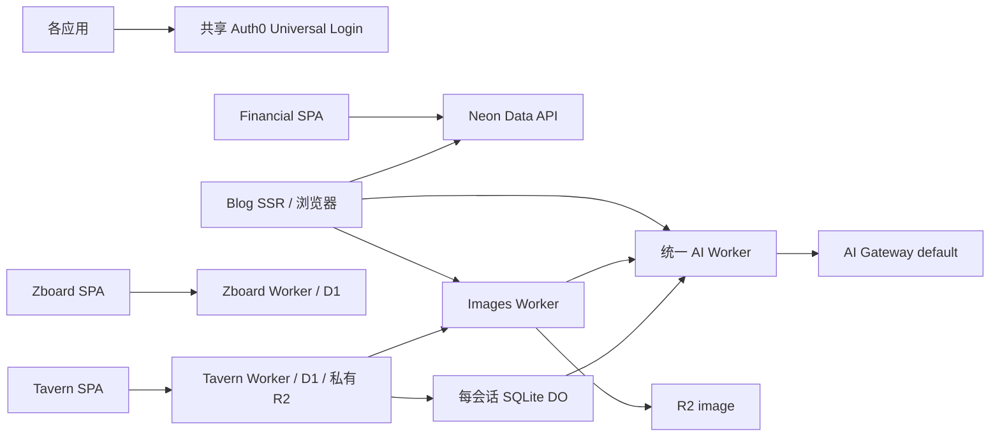

# Monorepo 架构

Hasbai 使用 pnpm workspace：`apps/*` 为独立应用，`packages/*` 提供共享能力。仓库历史名 `financial` 不代表其他应用受财务边界约束。

## 应用与数据流

| 应用 | 前端 / Worker | 业务存储与调用 |
| --- | --- | --- |
| [Financial](financial/ARCHITECTURE.md) | Svelte 5 SPA；Worker `financial` 托管静态资源 | 浏览器直连 Neon Data API（`financial` 三表、报表视图及写函数） |
| [Blog](blog/ARCHITECTURE.md) | SvelteKit SSR；Worker `blog`（`hasbai.xyz` / `blog.hasbai.xyz`） | Neon `public` 表 + 私有 R2 快照；服务绑定 `IMAGES`、`AI_SERVICE` |
| [Zboard](zboard/ARCHITECTURE.md) | Svelte 5 SPA；Worker `zboard` | Worker 验签、D1 用户/节点/模板/报告、订阅与 Node API |
| [Images](images/README.md) | Svelte 5 SPA；Worker `images` | 统一 R2 `image`、Neon `public.image`、服务绑定 `AI_SERVICE` |
| [AI](ai/README.md) | Svelte 5 SPA；Worker `ai`（`ai.hasbai.xyz`） | Cloudflare AI Gateway、Workers AI、自定义 Provider 与 BYOK |
| [WeChat](wechat/README.md) | 无界面 Worker `wechat`（`wechat.hasbai.xyz`） | 每用户 SQLite DO 存 Bot 凭据、游标、会话与消息；alarm 长轮询；MCP |
| [Tavern](tavern/ARCHITECTURE.md) | Svelte 5 SPA；Worker `tavern` | D1 目录/角色/世界书/设置；每会话 SQLite DO；私有 R2；`AI_SERVICE` |

签名、audience 与授权执行点见[AUTHORIZATION](AUTHORIZATION.md)；视觉与组件复用见[DESIGN](DESIGN.md)。根脚本默认代理财务；财务相对路径以 `apps/financial` 为工作目录。

## 共享包

| 包 | 职责 | 不包含 |
| --- | --- | --- |
| `packages/ai` | 统一 AI 服务绑定客户端、调用归属与取消 | 上游凭据与管理权限 |
| `packages/ui` | Luma primitives、通知、可复用交互组件 | 应用报表或业务权限 |
| `packages/auth` | SDK 工厂、公开配置、公共 claims 与 permission helper | 密码、管理凭据、逐轮用户资料查询 |
| `packages/data` | Neon PostgREST 客户端工厂 | 应用 repository 与业务视图 |
| `packages/images` | 图片类型、大小限制、模型白名单及资源契约 | 存储凭据与业务权限 |
| `packages/messaging` | Telegram 协议、验签、触发判断与分片发送 | 酒馆账号、角色或记忆 |
| `packages/observability` | 脱敏请求摘要、状态分级与响应就绪计时；见[日志说明](OBSERVABILITY.md) | 请求正文、凭据及外部日志服务 |
| `packages/markdown` | 安全 Markdown 渲染与阅读组件、数学/引用/图表扩展 | 内容自动改写或发布决策 |

## 自动构建与运行入口

Cloudflare Workers Builds 监听 `main` 自动构建发布（GitHub Actions 只负责 PR 验收，不部署）。2026-10-10 回查的 Cloudflare `repo_connection` 名称仍为历史 `hasbai/financial`，交付时按实际 Build SHA 核对。根 `wrangler.jsonc` 保留财务静态入口兼容。

| 应用 | 已登记构建入口 | 配置与版本核验入口 |
| --- | --- | --- |
| Financial | `apps/financial`；`pnpm build` | `apps/financial/wrangler.jsonc`；线上 HTML 与静态资源 |
| Blog | `apps/blog`；`pnpm build`（含 workerd 检查） | `apps/blog/wrangler.jsonc`；`/api/version`、SSR |
| Zboard | 仓库根；`pnpm --filter zboard build` | `apps/zboard/wrangler.jsonc`；Worker 版本与线上资源 |
| Images | `apps/images`；`pnpm build` | `apps/images/wrangler.jsonc`；`/health`、公开图片与生成 API |
| AI | `apps/ai`（见 [AI 服务](ai/README.md#配置与发布)） | `apps/ai/wrangler.jsonc`；`/health`、`/v1/models` |
| WeChat | `apps/wechat`；`pnpm build` | `apps/wechat/wrangler.jsonc`；`/health`、`wechat_list_accounts` |
| Tavern | 仓库根；`pnpm --filter tavern build` | `apps/tavern/wrangler.jsonc`；`/health` 与部署版本 |

2026-10-10 回读的构建过滤：Financial `apps/financial/*`、Blog `apps/blog/*`、Tavern `apps/tavern/**`（均含 `packages/**` 与根 workspace/lockfile）；Zboard 为 `*`（全仓库）。发布与迁移验证执行要求见[TESTING](TESTING.md)。
