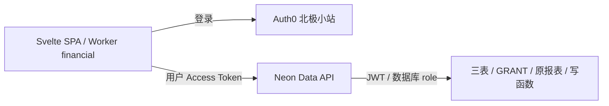

# 财务架构

应用采用 Svelte 5、TypeScript 与 Vite SPA（Bits UI / Luma、Tailwind CSS 4、Lucide）。Worker `financial` 只托管静态资源。浏览器通过 `packages/data` PostgREST 客户端直连 Neon Data API（`financial` 视图与写函数）。路径相对 `apps/financial`。

## 接入与资源

授权规则见 [AUTHORIZATION](../AUTHORIZATION.md)，业务边界见 [财务入口](README.md)。公开配置在 `src/lib/config.ts`。测试可以用 `VITE_DATA_API_URL` 指定已迁移分支。

既有 Neon 项目为 `mute-king-39794724` / `neondb`。生产分支为 `br-billowing-violet-b3pkbm3s`，开发分支为 `br-proud-bread-b3hl3asf`。操作前必须回读分支，不得用开发数据覆盖生产。维护脚本见 [DATABASE](DATABASE.md)。

## 应用结构与请求复用

- **页面与路由**：页面位于 `src/pages`（总览、流水、编辑、设置、科目）。`src/lib/router.svelte.ts` 维护 History API 路径与未保存提醒。`src/lib/context.ts` 注入 Repository（测试替身不得进入生产）。`src/lib/editor.ts` 初始化表单与退款分录（SQL 负责最终校验）。`src/lib/auth.svelte.ts` 初始化 Auth0（静默恢复超时 3 秒，未恢复则跳转登录）。`sessionStorage` 只存防循环与主动退出标记，不存 token。
- **查询与缓存（`src/lib/api.ts`、`src/lib/reports.ts`、`@tanstack/svelte-query`）**：
  - 冷启动读取六类源 GET：`balance`、`income_statement`、`cashflow`、`transactions`、完整 `account` 列表与 `balance_history`。超 1000 行按游标续页。隐藏金额时省去 `balance_history`。只有保存与删除走 RPC。
  - 报表、源行、科目与 `as_of` 在当前会话内保留，不因 30 秒过期、切页或聚焦重复请求。跨北京时间日切后重进页面刷新报表。保存交易使 overview 与 transactions 失效，不重读科目。保存科目使科目全量失效。退出清空同一 `QueryClient`（含在途查询，不存 `localStorage`）。
  - 资产负债、损益与每日历史面板复用原始行。`cashflow` 优先复用已覆盖目标半开区间的缓存，并按微秒边界裁剪。隐藏后首次显示金额只补 `balance_history`。重试只重读失败源。
- **计算与渲染**：`balance` 与 `balance_history` 物化视图直接授予 `superadmin` SELECT，保存同事务刷新（批量维护用 `scripts/refresh-balances.mjs`）。`numeric` 以十进制字符串经 `Decimal.js` 计算。SVG 坐标只用于呈现。`svelte-check` 校验 Svelte 与 TypeScript 6。

## 发布与回滚

`wrangler.jsonc` 配置 `dist`、SPA 回退与 `financial.hasbai.xyz`。`public/_headers` 设置安全与缓存头。Workers Builds 登记见 [Monorepo 架构](../ARCHITECTURE.md#自动构建与运行入口)。回滚优先退回 Worker 版本，不改动原三表字段或记录，也不调整其他 Auth0 application。

## iOS PWA

- **构建与缓存（`scripts/build-pwa.mjs`）**：构建生成带内容哈希清单的 `sw.js`，只预缓存公开静态资源。SW 不拦截跨域 Auth0/Neon、非 GET、带 `Authorization` 或带查询参数的运行时请求。导航优先 `no-store` 请求规范根路径 `/`。SW 不预取会触发 Cloudflare 重定向的 `/index.html`，并清除 `redirected` 标记后再供导航使用（回归以真实 HTTP 307 验证）。失败回退已安装的同版本应用壳。
- **更新与多标签安全**：新 SW 预缓存后执行 `skipWaiting` 与 `clients.claim`。更新不自动 `reload` 或 `navigate`，防止打断交易编辑。SW 只在激活且无打开窗口时清理旧 `financial-static` 缓存。启动、切回前台与恢复网络时合并检查更新。离线编辑保留输入并禁用保存，不设离线数据库或后台队列。
- **移动端视口**：`mobile-viewport.ts` 在未缩放时用 `VisualViewport` 高度与 `offsetTop` 适配键盘。手机交易路由使用独立页面（桌面使用 Dialog），防止导航或底栏遮挡。真机安装、升级、系统返回与键盘行为必须独立验收。
