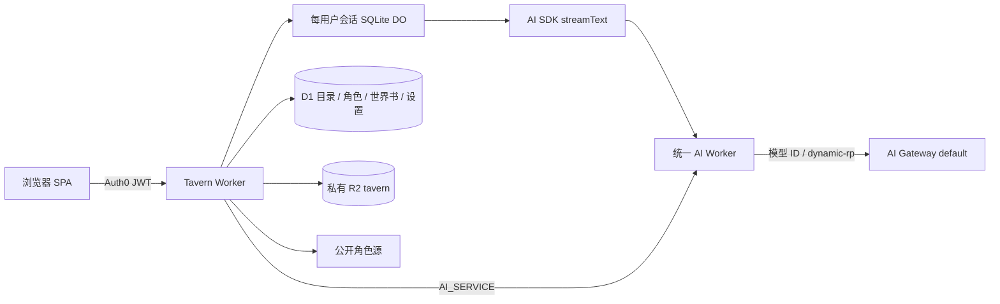

# Tavern 架构与产品契约

边界与路由见 [README](README.md)，当前证据限制见 [PROGRESS](PROGRESS.md)，辅助图解见 [ARCHITECTURE.html](ARCHITECTURE.html)。源码相对 `apps/tavern`。

## 产品与范围

Telegram 与浏览器共用同一会话 Agent（渠道契约见 [MESSAGING](MESSAGING.md)）。

| 页面 | 可执行功能 |
| --- | --- |
| 角色库 | 搜索已安装角色，导入 JSON/PNG/CHARX。创建与编辑共用表单（含头像与立绘上传及 AI 生图）。查看来源、导出原卡、删除、选开场白开聊。 |
| 发现 | 关键词与公开来源搜索（Chub 默认，支持排序、分类与标签。TheatreLM 只支持关键词与原序）。分页、查看作者与源页、内容去重安装。 |
| 世界书 | 独立 JSON 导入与导出、编辑原文、启停并绑定会话（内嵌角色书自动生效）。 |
| 对话 | 会话列表、右侧用户气泡、无气泡角色正文、单行自伸展输入、发送与停止。支持末尾复制、编辑、重生成（截断后续）、导出 JSONL 与删除。 |
| 关于 | 按阶段展示架构与提示词编辑。普通用户改个人系统提示，管理员改应用提示词。 |
| 设置 | 模型（平台目录）、思考开关与采样参数、persona、系统提示、主题、背景立绘开关与透明度。 |

应用不执行外来 JS、Lua、正则脚本或 ST 扩展工具，未知扩展只保留在原卡导出中。应用不提供群聊、语音、虚构推荐、评分或示例历史。

## 架构与边界

`apps/tavern` 是 Svelte 5 / Vite SPA（`@hasbai/ui` Luma、Lucide、`@hasbai/auth`）。Worker `tavern`（`tavern.hasbai.xyz`）负责 JWT、D1、R2、搜索适配器、Prompt 与推理。

- **授权与存储**：JWT 与本人或管理员边界见 [AUTHORIZATION](../AUTHORIZATION.md)。DO 持久化、惰性迁移与删除契约见 [AGENT](AGENT.md#do与迁移一致性)。D1 `source_catalog` 与 `source_releases` 原子切换公开目录。私人表保存 `characters`、`worldbooks`、`sessions`、`messages`（旧迁移来源）与 `settings`。修改角色库不自动改动已有会话。可以使用 `PATCH /api/sessions/:id` 传 `characterId` 显式更新（生成中拒绝）。
- **导入与输入安全**：解析前校验文件大小、PNG chunk 与 CRC、ZIP 条目数、未压总量与路径遍历。远端安装 URL 只由适配器构造固定 HTTPS 主机，并逐跳校验重定向。聊天按纯文本转义 HTML，不自动抓取链接。

## 角色卡与世界书

- **表单与图片**：创建、编辑与生成共享表单。开场选择使用紧凑预览与随机或指定选项。头像与立绘上传支持 PNG、JPEG、WebP（≤ 5 MB）。生成经 `IMAGE_SERVICE` 存图床（头像 `gpt-image-2.5-flare`，立绘 `gpt-image-2.5-sunburst`）。取消或删卡不删除图床资产。图片经 `media.hasbai.xyz/cdn-cgi/image/` 输出 WebP（头像 160×160、立绘 ≤ 1024×1536）。边缘缓存 1 年，浏览器缓存 1 天，替换图片使用新 ID。
- **角色卡生成**：`POST /api/characters/generate` 用平台默认模型与 strict CCv2 JSON Schema（`task=character-generation`）生成草稿。只在可靠 `stop` 且 `parseCard` 通过后回填，不补模板、不重试，并保留用户填写姓名与作者元信息。
- **宏与世界书**：`system_prompt` 的 `{{original}}` 合并用户系统提示（`post_history_instructions` 置空）。系统支持 `{{char}}`、`{{user}}`、`<char>`、`<user>`（V3 nickname 优先）。`creator_notes`、标签与来源不进入 Prompt。世界书支持 V2/V3 book 与 ST entries 导入（支持禁用、constant、主与副关键词、`scan_depth`、`case_sensitive`、`priority`、`insertion_order`、`before_char`/`after_char`、有限递归）。TheatreLM 散文书导入时转为常驻条目。上下文估算与压缩见 [上下文与摘要](AGENT.md#上下文与摘要)。

## 生成、重试与编辑

`POST /api/sessions/:id/generate` 使用 UUID `requestId` 与每会话 DO。外层原生透传 SSE，断连后 DO 后台继续生成并保存。编辑与删除截断原会话后续消息，并使受影响摘要失效（`continue:true` 返回 400）。流式展示、检查与恢复见 [正文流式契约](AGENT.md#正文流式展示与检查)。独立 Director 见 [MODELS](MODELS.md#续聊候选内容与-ui)。

## 应用提示词

Cloudflare KV `PROMPTS` 使用 `dialogue-v3`（缺失时兼容读取 `dialogue-v2` 转换，但不写回）。正文写作与事实边界已合入 `systemTemplate`，`tools` 存工具指导。候选、压缩与创作分别独立可编辑，运行不追加隐藏规则。`GET /api/prompts` 登录可读，`PUT /api/prompts` 必须校验 `tavern.all:all`。每回合读取一次配置并在正文、工具、摘要与 Director 间共用快照（指纹变化使旧投影失效）。普通用户修改个人系统提示前，先读最新设置再更新。关于页必须同步维护（见 [同步维护](README.md#同步维护)）。

## 对话与发现 UI

- 界面遵守 [共享交互反馈](../DESIGN.md#组件与交互)。酒馆禁用焦点边框与光圈，保留悬浮、按下、选中与键盘可达。按钮触控 ≥ 44px。顶部加载条不用于后台轮询或正文流。品牌图标复用北极小站雪花 SVG。
- 聊天页按 `VisualViewport` 布局，消息与会话列表各自滚动。移动端进入具体对话后隐藏底栏，并保留安全区。桌面折叠按钮位于主导航，保留草稿、阅读位置与生成状态。
- 阅读列最大 740px。界面采用右侧用户气泡、无气泡角色正文与顶部头像。页面支持全局或会话背景立绘（`characterBackground` 默认关闭、`backgroundOpacity` 默认 20）。发送与停止用 44px 圆形按钮。单行输入伸展至 200px，支持 `Enter` 发送、`Shift+Enter` 换行及中文 IME 保护。点击输入显示 `/compress`、`/status` 与 `/ooc` 命令。右下角显示上下文占用 `%`（含草稿，点击显示 `用量 / 容量 tokens`）。
- 流式增量与候选不抢焦点，也不强制滚底。执行记录按服务端顺序位于正文上方与下方，随后显示最多 3 张候选按钮。

## API 清单

- `GET /health`、`GET/PUT /api/prompts`、`GET/PUT /api/settings`、`GET /api/models`
- `POST /api/characters/generate`、`POST /api/characters/{avatar|portrait}/generate`、`GET/POST /api/characters`、`GET/PATCH/DELETE /api/characters/:id`、`GET /api/characters/:id/export`、`GET /api/characters/:id/{avatar|portrait}`
- `GET /api/discover`、`POST /api/install`
- `GET/POST /api/worldbooks`、`PATCH/DELETE /api/worldbooks/:id`、`GET /api/worldbooks/:id/export`
- `GET/POST /api/sessions`、`GET/PATCH/DELETE /api/sessions/:id`、`POST /api/sessions/:id/{generate|stop|command}`、`PATCH/DELETE /api/sessions/:id/messages`、`GET /api/sessions/:id/export`
- `GET /api/messaging/telegram`、`POST /api/messaging/telegram/{codes|bind|commands}`、`DELETE /api/messaging/telegram/:id`、`GET /api/messaging/telegram/:id/status`、`POST /api/messaging/telegram/:id/resolve`（详情见 [MESSAGING](MESSAGING.md)）

## 规范与公开来源

| 来源 | 契约与边界 |
| --- | --- |
| [CCv2](https://github.com/malfoyslastname/character-card-spec-v2/blob/main/spec_v2.md)、[CCv3](https://github.com/kwaroran/character-card-spec-v3/blob/main/SPEC_V3.md) | JSON、PNG、CHARX、未知扩展与原卡导出 |
| [SillyTavern World Info](https://docs.sillytavern.app/usage/core-concepts/worldinfo/) | 关键词、常驻、扫描深度、递归与排序 |
| [TheatreLM 目录](https://huggingface.co/datasets/G-reen/TheatreLM-v2.1-Characters) | 固定 revision `eb8597aec4e3e114b2d28b86c3e2496dd48c5af3`（5011 行校验、隔离 9 条损坏名后 5002 可用，保留 CC-BY-2.0 署名） |
| [Chub](https://docs.chub.ai/docs/the-basics/character-creation) | 固定适配器、排序与标签、标准 PNG 下载（不绕过保护） |
| [AI Gateway 统一 API](https://developers.cloudflare.com/ai-gateway/usage/chat-completion/) | 经 `AI_SERVICE` 调用统一 AI Worker（目录与日志契约见 [MODELS](MODELS.md)） |

首版未接入 RisuRealm 未文档化搜索或 CharaVault。

## 运行与兼容资源

本地前端 5176，独立 Worker API 8787（兼容日期 `2026-10-03`）。`pnpm --filter tavern test:session-runtime` 用真实 workerd 与 SQLite harness 验证会话生命周期（模型为夹具）。Workers Builds 从根运行 `pnpm --filter tavern build`。检查与交付见 [TESTING](../TESTING.md)。
